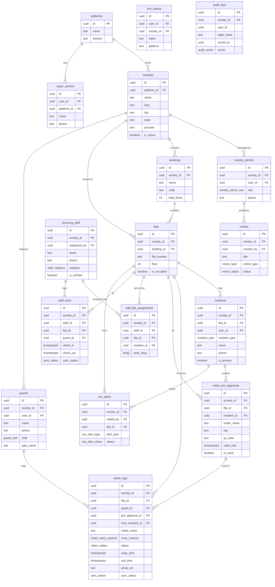

# Society Management SaaS — Database Design Document

**Platform:** Supabase (PostgreSQL 15+)
**Architecture:** Multi-tenant SaaS (shared schema, row-level isolation)
**Region / Timezone:** India (Asia/Kolkata, IST UTC+5:30)
**Primary Identity:** Mobile phone number (Indian format)
**Last Updated:** 2026-07-31

---

## Table of Contents

1. [Entity Overview](#1-entity-overview)
2. [Multi-Tenancy Strategy](#2-multi-tenancy-strategy)
3. [Enum Types](#3-enum-types)
4. [Full SQL Schema](#4-full-sql-schema)
5. [Row Level Security Policies](#5-row-level-security-policies)
6. [Entity Relationship Diagram](#6-entity-relationship-diagram)
7. [Indexes for Performance](#7-indexes-for-performance)
8. [Offline Sync Strategy for Guards](#8-offline-sync-strategy-for-guards)
9. [Storage Buckets](#9-storage-buckets)
10. [Realtime Subscriptions](#10-realtime-subscriptions)
11. [Key Design Decisions](#11-key-design-decisions)

---

## 1. Entity Overview

| Table | Tenant-Scoped | Purpose |
|---|---|---|
| `platforms` | No | Single platform record (SaaS operator metadata) |
| `super_admins` | No | Platform-level admins with full access |
| `societies` | No (root) | Each registered housing society |
| `society_admins` | Yes | Society-level admins (committee members) |
| `buildings` | Yes | Towers / blocks within a society |
| `flats` | Yes | Individual units within a building |
| `residents` | Yes | Flat owners and tenants linked to a flat |
| `guards` | Yes | Security staff at society gates |
| `visitor_logs` | Yes | Every visitor entry/exit event |
| `visitor_pre_approvals` | Yes | Pre-approved visitors (OTP / QR based) |
| `recurring_staff` | Yes | Registered domestic staff (maid, cook, etc.) |
| `staff_visits` | Yes | Daily check-in/check-out of recurring staff |
| `notices` | Yes | Society announcements and circulars |
| `sos_alerts` | Yes | Emergency alerts raised by residents |
| `fcm_tokens` | Yes | Push notification device tokens (FCM) |
| `audit_logs` | Yes | Immutable change trail for critical actions |

---

## 2. Multi-Tenancy Strategy

### Approach: Shared Schema with `society_id` Row Isolation

All tenant-specific tables include a `society_id UUID NOT NULL` column that references `societies(id)`. Supabase Row Level Security (RLS) enforces data boundaries at the database layer — no tenant can read or write another tenant's data, regardless of application logic.

### How It Works

1. **JWT Claims:** When a user authenticates via Supabase Auth, a custom JWT claim `society_id` is embedded using a Postgres function triggered by `auth.users` or via a custom token enrichment hook.

2. **RLS Predicate:** Every policy on tenant-scoped tables includes:
   ```sql
   society_id = (current_setting('request.jwt.claims', true)::jsonb ->> 'society_id')::uuid
   ```

3. **Supabase Auth UID mapping:** `auth.uid()` maps to the `user_id` on `residents`, `guards`, or `super_admins` tables, driving role resolution.

4. **Service Role Bypass:** Background jobs (notifications, archival) use the Supabase service role key, which bypasses RLS. These are never exposed to clients.

### JWT Custom Claims Structure

```json
{
  "sub": "<auth.uid>",
  "role": "resident",
  "society_id": "<uuid>",
  "flat_id": "<uuid>",
  "resident_type": "flat_owner"
}
```

Claims are populated by a Postgres function called on each login:

```sql
-- Supabase Auth Hook: custom_access_token_hook
CREATE OR REPLACE FUNCTION public.custom_access_token_hook(event jsonb)
RETURNS jsonb
LANGUAGE plpgsql STABLE
AS $$
DECLARE
  claims jsonb;
  v_society_id uuid;
  v_role text;
  v_flat_id uuid;
  v_resident_type text;
BEGIN
  claims := event -> 'claims';

  -- Try residents table first
  SELECT r.flat_id, r.resident_type, f.society_id
    INTO v_flat_id, v_resident_type, v_society_id
    FROM public.residents r
    JOIN public.flats f ON f.id = r.flat_id
   WHERE r.user_id = (event ->> 'user_id')::uuid
     AND r.is_active = true
   LIMIT 1;

  IF v_society_id IS NOT NULL THEN
    v_role := 'resident';
  ELSE
    -- Try guards
    SELECT g.society_id INTO v_society_id
      FROM public.guards g
     WHERE g.user_id = (event ->> 'user_id')::uuid
       AND g.is_active = true
     LIMIT 1;
    IF v_society_id IS NOT NULL THEN v_role := 'guard'; END IF;
  END IF;

  IF v_society_id IS NOT NULL THEN
    claims := jsonb_set(claims, '{society_id}', to_jsonb(v_society_id::text));
    claims := jsonb_set(claims, '{role}', to_jsonb(v_role));
    IF v_flat_id IS NOT NULL THEN
      claims := jsonb_set(claims, '{flat_id}', to_jsonb(v_flat_id::text));
      claims := jsonb_set(claims, '{resident_type}', to_jsonb(v_resident_type));
    END IF;
  END IF;

  RETURN jsonb_set(event, '{claims}', claims);
END;
$$;
```

---

## 3. Enum Types

```sql
-- ============================================================
-- ENUM TYPES
-- ============================================================

CREATE TYPE public.resident_type AS ENUM (
  'flat_owner',
  'tenant',
  'family_member'
);

CREATE TYPE public.visitor_entry_method AS ENUM (
  'manual',        -- guard types details manually
  'qr_scan',       -- resident-generated QR code scanned at gate
  'otp',           -- OTP pre-approval
  'facial'         -- future: facial recognition
);

CREATE TYPE public.visitor_status AS ENUM (
  'pending',       -- waiting at gate, approval not yet given
  'approved',      -- entry allowed
  'denied',        -- entry refused
  'inside',        -- currently on premises
  'exited'         -- checked out
);

CREATE TYPE public.staff_category AS ENUM (
  'maid',
  'cook',
  'driver',
  'nanny',
  'gardener',
  'plumber',
  'electrician',
  'other'
);

CREATE TYPE public.notice_type AS ENUM (
  'general',
  'maintenance',
  'emergency',
  'event',
  'payment'
);

CREATE TYPE public.notice_status AS ENUM (
  'draft',
  'published',
  'archived'
);

CREATE TYPE public.sos_alert_type AS ENUM (
  'medical',
  'fire',
  'intrusion',
  'gas_leak',
  'other'
);

CREATE TYPE public.sos_alert_status AS ENUM (
  'active',
  'acknowledged',
  'resolved'
);

CREATE TYPE public.platform_role AS ENUM (
  'super_admin'
);

CREATE TYPE public.society_admin_role AS ENUM (
  'president',
  'secretary',
  'treasurer',
  'committee_member',
  'property_manager'
);

CREATE TYPE public.guard_shift AS ENUM (
  'morning',   -- 06:00 – 14:00
  'afternoon', -- 14:00 – 22:00
  'night'      -- 22:00 – 06:00
);

CREATE TYPE public.sync_status AS ENUM (
  'pending',   -- created offline, not yet synced
  'synced',    -- confirmed by server
  'conflict'   -- server rejected / conflict detected
);

CREATE TYPE public.audit_action AS ENUM (
  'INSERT',
  'UPDATE',
  'DELETE'
);
```

---

## 4. Full SQL Schema

### 4.1 Helper Functions

```sql
-- ============================================================
-- HELPER FUNCTIONS
-- ============================================================

-- Returns the society_id from the current user's JWT
CREATE OR REPLACE FUNCTION public.current_society_id()
RETURNS uuid LANGUAGE sql STABLE AS $$
  SELECT (current_setting('request.jwt.claims', true)::jsonb ->> 'society_id')::uuid;
$$;

-- Returns the role from the current user's JWT
CREATE OR REPLACE FUNCTION public.current_role_claim()
RETURNS text LANGUAGE sql STABLE AS $$
  SELECT current_setting('request.jwt.claims', true)::jsonb ->> 'role';
$$;

-- Returns true if the current user is a super admin
CREATE OR REPLACE FUNCTION public.is_super_admin()
RETURNS boolean LANGUAGE sql STABLE AS $$
  SELECT EXISTS (
    SELECT 1 FROM public.super_admins
     WHERE user_id = auth.uid() AND is_active = true
  );
$$;

-- Returns true if the current user is an admin of the given society
CREATE OR REPLACE FUNCTION public.is_society_admin(p_society_id uuid)
RETURNS boolean LANGUAGE sql STABLE AS $$
  SELECT EXISTS (
    SELECT 1 FROM public.society_admins
     WHERE user_id = auth.uid()
       AND society_id = p_society_id
       AND is_active = true
  );
$$;

-- Returns true if the current user is a guard of the given society
CREATE OR REPLACE FUNCTION public.is_guard(p_society_id uuid)
RETURNS boolean LANGUAGE sql STABLE AS $$
  SELECT EXISTS (
    SELECT 1 FROM public.guards
     WHERE user_id = auth.uid()
       AND society_id = p_society_id
       AND is_active = true
  );
$$;

-- Auto-update updated_at timestamp
CREATE OR REPLACE FUNCTION public.set_updated_at()
RETURNS trigger LANGUAGE plpgsql AS $$
BEGIN
  NEW.updated_at = now();
  RETURN NEW;
END;
$$;
```

---

### 4.2 Platform & Super Admin Tables

```sql
-- ============================================================
-- PLATFORMS
-- ============================================================
-- One row: the SaaS platform itself. Exists mainly for audit
-- and configuration purposes.

CREATE TABLE public.platforms (
  id            uuid PRIMARY KEY DEFAULT gen_random_uuid(),
  name          text NOT NULL DEFAULT 'MyGate SaaS',
  domain        text UNIQUE,
  support_email text,
  support_phone text,
  settings      jsonb NOT NULL DEFAULT '{}',
  created_at    timestamptz NOT NULL DEFAULT now(),
  updated_at    timestamptz NOT NULL DEFAULT now()
);

CREATE TRIGGER trg_platforms_updated_at
  BEFORE UPDATE ON public.platforms
  FOR EACH ROW EXECUTE FUNCTION public.set_updated_at();

-- Seed the single platform record
INSERT INTO public.platforms (name) VALUES ('Society360');


-- ============================================================
-- SUPER_ADMINS
-- ============================================================
-- Maps Supabase auth users to the platform super-admin role.

CREATE TABLE public.super_admins (
  id            uuid PRIMARY KEY DEFAULT gen_random_uuid(),
  user_id       uuid NOT NULL REFERENCES auth.users(id) ON DELETE CASCADE,
  platform_id   uuid NOT NULL REFERENCES public.platforms(id) ON DELETE CASCADE,
  role          public.platform_role NOT NULL DEFAULT 'super_admin',
  name          text NOT NULL,
  email         text NOT NULL,
  phone         text,                   -- E.164 format: +91XXXXXXXXXX
  is_active     boolean NOT NULL DEFAULT true,
  last_login_at timestamptz,
  created_at    timestamptz NOT NULL DEFAULT now(),
  updated_at    timestamptz NOT NULL DEFAULT now(),
  CONSTRAINT super_admins_user_id_key UNIQUE (user_id)
);

CREATE TRIGGER trg_super_admins_updated_at
  BEFORE UPDATE ON public.super_admins
  FOR EACH ROW EXECUTE FUNCTION public.set_updated_at();
```

---

### 4.3 Society Tables

```sql
-- ============================================================
-- SOCIETIES
-- ============================================================

CREATE TABLE public.societies (
  id               uuid PRIMARY KEY DEFAULT gen_random_uuid(),
  platform_id      uuid NOT NULL REFERENCES public.platforms(id),
  name             text NOT NULL,
  slug             text NOT NULL UNIQUE,         -- URL-friendly identifier
  address_line1    text NOT NULL,
  address_line2    text,
  city             text NOT NULL,
  state            text NOT NULL DEFAULT 'Maharashtra',
  pincode          text NOT NULL,
  country          text NOT NULL DEFAULT 'India',
  latitude         numeric(9,6),
  longitude        numeric(9,6),
  total_flats      int NOT NULL DEFAULT 0,
  registration_no  text,                          -- Society registration number
  contact_email    text,
  contact_phone    text,
  logo_url         text,
  settings         jsonb NOT NULL DEFAULT '{}',  -- Feature flags, branding
  subscription_plan text NOT NULL DEFAULT 'free', -- free | basic | premium
  subscription_valid_until date,
  is_active        boolean NOT NULL DEFAULT true,
  created_at       timestamptz NOT NULL DEFAULT now(),
  updated_at       timestamptz NOT NULL DEFAULT now()
);

CREATE TRIGGER trg_societies_updated_at
  BEFORE UPDATE ON public.societies
  FOR EACH ROW EXECUTE FUNCTION public.set_updated_at();

CREATE INDEX idx_societies_platform_id ON public.societies(platform_id);
CREATE INDEX idx_societies_slug ON public.societies(slug);
CREATE INDEX idx_societies_is_active ON public.societies(is_active) WHERE is_active = true;


-- ============================================================
-- SOCIETY_ADMINS
-- ============================================================

CREATE TABLE public.society_admins (
  id          uuid PRIMARY KEY DEFAULT gen_random_uuid(),
  society_id  uuid NOT NULL REFERENCES public.societies(id) ON DELETE CASCADE,
  user_id     uuid NOT NULL REFERENCES auth.users(id) ON DELETE CASCADE,
  role        public.society_admin_role NOT NULL DEFAULT 'committee_member',
  name        text NOT NULL,
  email       text,
  phone       text NOT NULL,            -- Primary login identity
  flat_id     uuid,                     -- If admin also lives in society
  is_active   boolean NOT NULL DEFAULT true,
  created_at  timestamptz NOT NULL DEFAULT now(),
  updated_at  timestamptz NOT NULL DEFAULT now(),
  CONSTRAINT society_admins_society_user_key UNIQUE (society_id, user_id)
);

CREATE TRIGGER trg_society_admins_updated_at
  BEFORE UPDATE ON public.society_admins
  FOR EACH ROW EXECUTE FUNCTION public.set_updated_at();

CREATE INDEX idx_society_admins_society_id ON public.society_admins(society_id);
CREATE INDEX idx_society_admins_user_id ON public.society_admins(user_id);
```

---

### 4.4 Building & Flat Tables

```sql
-- ============================================================
-- BUILDINGS
-- ============================================================
-- Represents towers / wings / blocks within a society.

CREATE TABLE public.buildings (
  id          uuid PRIMARY KEY DEFAULT gen_random_uuid(),
  society_id  uuid NOT NULL REFERENCES public.societies(id) ON DELETE CASCADE,
  name        text NOT NULL,            -- e.g. "Tower A", "Block B"
  code        text NOT NULL,            -- Short code: "A", "B", "T1"
  total_floors int NOT NULL DEFAULT 1,
  description text,
  is_active   boolean NOT NULL DEFAULT true,
  created_at  timestamptz NOT NULL DEFAULT now(),
  updated_at  timestamptz NOT NULL DEFAULT now(),
  CONSTRAINT buildings_society_code_key UNIQUE (society_id, code)
);

CREATE TRIGGER trg_buildings_updated_at
  BEFORE UPDATE ON public.buildings
  FOR EACH ROW EXECUTE FUNCTION public.set_updated_at();

CREATE INDEX idx_buildings_society_id ON public.buildings(society_id);


-- ============================================================
-- FLATS
-- ============================================================
-- Individual units. A flat belongs to exactly one building.

CREATE TABLE public.flats (
  id              uuid PRIMARY KEY DEFAULT gen_random_uuid(),
  society_id      uuid NOT NULL REFERENCES public.societies(id) ON DELETE CASCADE,
  building_id     uuid NOT NULL REFERENCES public.buildings(id) ON DELETE CASCADE,
  flat_number     text NOT NULL,           -- e.g. "101", "A-201"
  floor           int NOT NULL DEFAULT 1,
  flat_type       text,                    -- e.g. "2BHK", "3BHK"
  area_sqft       numeric(8,2),
  intercom_number text,
  is_occupied     boolean NOT NULL DEFAULT false,
  is_active       boolean NOT NULL DEFAULT true,
  created_at      timestamptz NOT NULL DEFAULT now(),
  updated_at      timestamptz NOT NULL DEFAULT now(),
  CONSTRAINT flats_building_number_key UNIQUE (building_id, flat_number)
);

CREATE TRIGGER trg_flats_updated_at
  BEFORE UPDATE ON public.flats
  FOR EACH ROW EXECUTE FUNCTION public.set_updated_at();

CREATE INDEX idx_flats_society_id ON public.flats(society_id);
CREATE INDEX idx_flats_building_id ON public.flats(building_id);
CREATE INDEX idx_flats_is_occupied ON public.flats(society_id, is_occupied);
```

---

### 4.5 Residents Table

```sql
-- ============================================================
-- RESIDENTS
-- ============================================================
-- One flat can have multiple residents: owner, tenants, family.
-- Each resident has their own app login (user_id).

CREATE TABLE public.residents (
  id              uuid PRIMARY KEY DEFAULT gen_random_uuid(),
  society_id      uuid NOT NULL REFERENCES public.societies(id) ON DELETE CASCADE,
  flat_id         uuid NOT NULL REFERENCES public.flats(id) ON DELETE CASCADE,
  user_id         uuid REFERENCES auth.users(id) ON DELETE SET NULL,
  resident_type   public.resident_type NOT NULL,
  name            text NOT NULL,
  phone           text NOT NULL,           -- E.164: +91XXXXXXXXXX
  email           text,
  profile_pic_url text,
  date_of_birth   date,
  id_type         text,                    -- Aadhaar, PAN, Passport, DL
  id_number       text,                    -- masked in application layer
  vehicle_numbers text[],                  -- e.g. ['MH12AB1234']
  move_in_date    date,
  move_out_date   date,
  is_primary      boolean NOT NULL DEFAULT false,  -- Primary contact for flat
  is_active       boolean NOT NULL DEFAULT true,
  emergency_contact_name  text,
  emergency_contact_phone text,
  created_at      timestamptz NOT NULL DEFAULT now(),
  updated_at      timestamptz NOT NULL DEFAULT now(),
  CONSTRAINT residents_society_phone_key UNIQUE (society_id, phone),
  CONSTRAINT residents_user_id_key UNIQUE (user_id)
);

-- Ensure each flat has at most one primary resident
CREATE UNIQUE INDEX idx_residents_one_primary_per_flat
  ON public.residents(flat_id)
  WHERE is_primary = true AND is_active = true;

CREATE TRIGGER trg_residents_updated_at
  BEFORE UPDATE ON public.residents
  FOR EACH ROW EXECUTE FUNCTION public.set_updated_at();

CREATE INDEX idx_residents_society_id ON public.residents(society_id);
CREATE INDEX idx_residents_flat_id ON public.residents(flat_id);
CREATE INDEX idx_residents_user_id ON public.residents(user_id);
CREATE INDEX idx_residents_phone ON public.residents(phone);
```

---

### 4.6 Guards Table

```sql
-- ============================================================
-- GUARDS
-- ============================================================

CREATE TABLE public.guards (
  id              uuid PRIMARY KEY DEFAULT gen_random_uuid(),
  society_id      uuid NOT NULL REFERENCES public.societies(id) ON DELETE CASCADE,
  user_id         uuid REFERENCES auth.users(id) ON DELETE SET NULL,
  name            text NOT NULL,
  phone           text NOT NULL,
  profile_pic_url text,
  employee_id     text,
  shift           public.guard_shift NOT NULL DEFAULT 'morning',
  gate_name       text,                  -- e.g. "Main Gate", "Back Gate"
  is_active       boolean NOT NULL DEFAULT true,
  last_sync_at    timestamptz,           -- Last successful offline sync
  created_at      timestamptz NOT NULL DEFAULT now(),
  updated_at      timestamptz NOT NULL DEFAULT now(),
  CONSTRAINT guards_society_phone_key UNIQUE (society_id, phone)
);

CREATE TRIGGER trg_guards_updated_at
  BEFORE UPDATE ON public.guards
  FOR EACH ROW EXECUTE FUNCTION public.set_updated_at();

CREATE INDEX idx_guards_society_id ON public.guards(society_id);
CREATE INDEX idx_guards_user_id ON public.guards(user_id);
```

---

### 4.7 Visitor Management Tables

```sql
-- ============================================================
-- VISITOR_LOGS
-- ============================================================
-- Central log of every visitor who arrives at the gate.
-- Created by guard (manual / QR / OTP).
-- Supports offline creation with sync_status tracking.

CREATE TABLE public.visitor_logs (
  id                  uuid PRIMARY KEY DEFAULT gen_random_uuid(),
  society_id          uuid NOT NULL REFERENCES public.societies(id) ON DELETE CASCADE,
  flat_id             uuid REFERENCES public.flats(id) ON DELETE SET NULL,
  guard_id            uuid REFERENCES public.guards(id) ON DELETE SET NULL,
  pre_approval_id     uuid,               -- FK added after pre_approvals table
  visitor_name        text NOT NULL,
  visitor_phone       text,               -- E.164
  visitor_company     text,
  purpose             text,
  vehicle_number      text,
  photo_url           text,               -- Supabase Storage URL
  entry_method        public.visitor_entry_method NOT NULL DEFAULT 'manual',
  status              public.visitor_status NOT NULL DEFAULT 'pending',
  entry_time          timestamptz,
  exit_time           timestamptz,
  expected_flat_id    uuid REFERENCES public.flats(id) ON DELETE SET NULL,
  host_resident_id    uuid REFERENCES public.residents(id) ON DELETE SET NULL,
  approval_by         uuid REFERENCES public.residents(id) ON DELETE SET NULL,
  approval_time       timestamptz,
  denial_reason       text,
  gate_name           text,
  device_id           text,               -- Guard device identifier (offline sync)
  sync_status         public.sync_status NOT NULL DEFAULT 'synced',
  local_id            text,               -- Client-side UUID for dedup during sync
  notes               text,
  created_at          timestamptz NOT NULL DEFAULT now(),
  updated_at          timestamptz NOT NULL DEFAULT now(),
  -- Prevent duplicate syncs of the same offline record
  CONSTRAINT visitor_logs_local_id_device_key UNIQUE (device_id, local_id)
);

CREATE TRIGGER trg_visitor_logs_updated_at
  BEFORE UPDATE ON public.visitor_logs
  FOR EACH ROW EXECUTE FUNCTION public.set_updated_at();

-- Composite index for guard dashboard queries (today's entries per gate)
CREATE INDEX idx_visitor_logs_society_entry ON public.visitor_logs(society_id, entry_time DESC);
CREATE INDEX idx_visitor_logs_flat_id ON public.visitor_logs(flat_id);
CREATE INDEX idx_visitor_logs_guard_id ON public.visitor_logs(guard_id);
CREATE INDEX idx_visitor_logs_status ON public.visitor_logs(society_id, status)
  WHERE status IN ('pending', 'inside');
CREATE INDEX idx_visitor_logs_sync_status ON public.visitor_logs(sync_status)
  WHERE sync_status = 'pending';
CREATE INDEX idx_visitor_logs_visitor_phone ON public.visitor_logs(visitor_phone)
  WHERE visitor_phone IS NOT NULL;


-- ============================================================
-- VISITOR_PRE_APPROVALS
-- ============================================================
-- Residents pre-approve visitors via OTP or QR code.

CREATE TABLE public.visitor_pre_approvals (
  id              uuid PRIMARY KEY DEFAULT gen_random_uuid(),
  society_id      uuid NOT NULL REFERENCES public.societies(id) ON DELETE CASCADE,
  flat_id         uuid NOT NULL REFERENCES public.flats(id) ON DELETE CASCADE,
  resident_id     uuid NOT NULL REFERENCES public.residents(id) ON DELETE CASCADE,
  visitor_name    text NOT NULL,
  visitor_phone   text,
  purpose         text,
  valid_from      timestamptz NOT NULL,
  valid_until     timestamptz NOT NULL,
  otp             text,                   -- 6-digit, hashed with pgcrypto
  otp_expires_at  timestamptz,
  qr_code         text,                   -- Signed JWT or UUID token
  is_used         boolean NOT NULL DEFAULT false,
  used_at         timestamptz,
  max_uses        int NOT NULL DEFAULT 1, -- For frequent visitors: set higher
  use_count       int NOT NULL DEFAULT 0,
  is_active       boolean NOT NULL DEFAULT true,
  created_at      timestamptz NOT NULL DEFAULT now(),
  updated_at      timestamptz NOT NULL DEFAULT now(),
  CONSTRAINT pre_approval_valid_range CHECK (valid_until > valid_from),
  CONSTRAINT pre_approval_use_count CHECK (use_count <= max_uses)
);

CREATE TRIGGER trg_visitor_pre_approvals_updated_at
  BEFORE UPDATE ON public.visitor_pre_approvals
  FOR EACH ROW EXECUTE FUNCTION public.set_updated_at();

CREATE INDEX idx_pre_approvals_society_id ON public.visitor_pre_approvals(society_id);
CREATE INDEX idx_pre_approvals_flat_id ON public.visitor_pre_approvals(flat_id);
CREATE INDEX idx_pre_approvals_resident_id ON public.visitor_pre_approvals(resident_id);
CREATE INDEX idx_pre_approvals_otp ON public.visitor_pre_approvals(otp) WHERE otp IS NOT NULL;
CREATE INDEX idx_pre_approvals_qr_code ON public.visitor_pre_approvals(qr_code) WHERE qr_code IS NOT NULL;
CREATE INDEX idx_pre_approvals_valid_until ON public.visitor_pre_approvals(valid_until)
  WHERE is_active = true;

-- Back-reference FK from visitor_logs
ALTER TABLE public.visitor_logs
  ADD CONSTRAINT visitor_logs_pre_approval_id_fkey
    FOREIGN KEY (pre_approval_id) REFERENCES public.visitor_pre_approvals(id) ON DELETE SET NULL;
```

---

### 4.8 Recurring Staff Tables

```sql
-- ============================================================
-- RECURRING_STAFF
-- ============================================================
-- Domestic staff registered by a flat's residents.
-- On arrival, guard matches them quickly without full visitor flow.

CREATE TABLE public.recurring_staff (
  id              uuid PRIMARY KEY DEFAULT gen_random_uuid(),
  society_id      uuid NOT NULL REFERENCES public.societies(id) ON DELETE CASCADE,
  name            text NOT NULL,
  phone           text,
  photo_url       text,
  category        public.staff_category NOT NULL,
  id_proof_url    text,                   -- Storage URL for uploaded ID
  registered_by   uuid REFERENCES public.residents(id) ON DELETE SET NULL,
  is_verified     boolean NOT NULL DEFAULT false,  -- Society admin verifies
  is_blocked      boolean NOT NULL DEFAULT false,  -- Can be blocked by admin
  blocked_reason  text,
  created_at      timestamptz NOT NULL DEFAULT now(),
  updated_at      timestamptz NOT NULL DEFAULT now()
);

-- Junction table: which flats does this staff serve?
CREATE TABLE public.staff_flat_assignments (
  id            uuid PRIMARY KEY DEFAULT gen_random_uuid(),
  society_id    uuid NOT NULL REFERENCES public.societies(id) ON DELETE CASCADE,
  staff_id      uuid NOT NULL REFERENCES public.recurring_staff(id) ON DELETE CASCADE,
  flat_id       uuid NOT NULL REFERENCES public.flats(id) ON DELETE CASCADE,
  resident_id   uuid NOT NULL REFERENCES public.residents(id) ON DELETE CASCADE,
  work_days     text[] NOT NULL DEFAULT ARRAY['Mon','Tue','Wed','Thu','Fri'],
  work_hours    text,                     -- e.g. "07:00-09:00"
  is_active     boolean NOT NULL DEFAULT true,
  created_at    timestamptz NOT NULL DEFAULT now(),
  CONSTRAINT staff_flat_assignments_unique UNIQUE (staff_id, flat_id)
);

CREATE TRIGGER trg_recurring_staff_updated_at
  BEFORE UPDATE ON public.recurring_staff
  FOR EACH ROW EXECUTE FUNCTION public.set_updated_at();

CREATE INDEX idx_recurring_staff_society_id ON public.recurring_staff(society_id);
CREATE INDEX idx_recurring_staff_phone ON public.recurring_staff(phone) WHERE phone IS NOT NULL;
CREATE INDEX idx_staff_assignments_staff_id ON public.staff_flat_assignments(staff_id);
CREATE INDEX idx_staff_assignments_flat_id ON public.staff_flat_assignments(flat_id);
CREATE INDEX idx_staff_assignments_society_id ON public.staff_flat_assignments(society_id);


-- ============================================================
-- STAFF_VISITS
-- ============================================================
-- Daily check-in / check-out log for recurring staff.
-- Also offline-safe like visitor_logs.

CREATE TABLE public.staff_visits (
  id           uuid PRIMARY KEY DEFAULT gen_random_uuid(),
  society_id   uuid NOT NULL REFERENCES public.societies(id) ON DELETE CASCADE,
  staff_id     uuid NOT NULL REFERENCES public.recurring_staff(id) ON DELETE CASCADE,
  flat_id      uuid NOT NULL REFERENCES public.flats(id) ON DELETE CASCADE,
  guard_id     uuid REFERENCES public.guards(id) ON DELETE SET NULL,
  check_in     timestamptz NOT NULL DEFAULT now(),
  check_out    timestamptz,
  gate_name    text,
  photo_url    text,                      -- Photo at check-in
  notes        text,
  device_id    text,
  sync_status  public.sync_status NOT NULL DEFAULT 'synced',
  local_id     text,
  created_at   timestamptz NOT NULL DEFAULT now(),
  CONSTRAINT staff_visits_local_dedup UNIQUE (device_id, local_id)
);

CREATE INDEX idx_staff_visits_society_id ON public.staff_visits(society_id);
CREATE INDEX idx_staff_visits_staff_id ON public.staff_visits(staff_id);
CREATE INDEX idx_staff_visits_flat_id ON public.staff_visits(flat_id);
CREATE INDEX idx_staff_visits_check_in ON public.staff_visits(society_id, check_in DESC);
CREATE INDEX idx_staff_visits_sync_status ON public.staff_visits(sync_status)
  WHERE sync_status = 'pending';
```

---

### 4.9 Notices Table

```sql
-- ============================================================
-- NOTICES
-- ============================================================

CREATE TABLE public.notices (
  id            uuid PRIMARY KEY DEFAULT gen_random_uuid(),
  society_id    uuid NOT NULL REFERENCES public.societies(id) ON DELETE CASCADE,
  created_by    uuid NOT NULL REFERENCES public.society_admins(id),
  title         text NOT NULL,
  body          text NOT NULL,
  notice_type   public.notice_type NOT NULL DEFAULT 'general',
  status        public.notice_status NOT NULL DEFAULT 'draft',
  is_pinned     boolean NOT NULL DEFAULT false,
  attachment_url text,
  target_buildings uuid[],               -- NULL = all buildings
  target_flats    uuid[],                -- NULL = all flats
  published_at  timestamptz,
  expires_at    timestamptz,
  view_count    int NOT NULL DEFAULT 0,
  created_at    timestamptz NOT NULL DEFAULT now(),
  updated_at    timestamptz NOT NULL DEFAULT now()
);

CREATE TRIGGER trg_notices_updated_at
  BEFORE UPDATE ON public.notices
  FOR EACH ROW EXECUTE FUNCTION public.set_updated_at();

CREATE INDEX idx_notices_society_id ON public.notices(society_id);
CREATE INDEX idx_notices_status ON public.notices(society_id, status, published_at DESC)
  WHERE status = 'published';
CREATE INDEX idx_notices_is_pinned ON public.notices(society_id, is_pinned)
  WHERE is_pinned = true;
```

---

### 4.10 SOS Alerts Table

```sql
-- ============================================================
-- SOS_ALERTS
-- ============================================================

CREATE TABLE public.sos_alerts (
  id            uuid PRIMARY KEY DEFAULT gen_random_uuid(),
  society_id    uuid NOT NULL REFERENCES public.societies(id) ON DELETE CASCADE,
  raised_by     uuid NOT NULL REFERENCES public.residents(id),
  flat_id       uuid NOT NULL REFERENCES public.flats(id),
  alert_type    public.sos_alert_type NOT NULL,
  description   text,
  latitude      numeric(9,6),
  longitude     numeric(9,6),
  status        public.sos_alert_status NOT NULL DEFAULT 'active',
  acknowledged_by uuid REFERENCES public.guards(id) ON DELETE SET NULL,
  acknowledged_at timestamptz,
  resolved_by   uuid REFERENCES public.society_admins(id) ON DELETE SET NULL,
  resolved_at   timestamptz,
  resolution_note text,
  created_at    timestamptz NOT NULL DEFAULT now(),
  updated_at    timestamptz NOT NULL DEFAULT now()
);

CREATE TRIGGER trg_sos_alerts_updated_at
  BEFORE UPDATE ON public.sos_alerts
  FOR EACH ROW EXECUTE FUNCTION public.set_updated_at();

CREATE INDEX idx_sos_alerts_society_id ON public.sos_alerts(society_id);
CREATE INDEX idx_sos_alerts_status ON public.sos_alerts(society_id, status)
  WHERE status IN ('active', 'acknowledged');
CREATE INDEX idx_sos_alerts_raised_by ON public.sos_alerts(raised_by);
CREATE INDEX idx_sos_alerts_created_at ON public.sos_alerts(society_id, created_at DESC);
```

---

### 4.11 FCM Tokens Table

```sql
-- ============================================================
-- FCM_TOKENS
-- ============================================================
-- Stores Firebase Cloud Messaging push tokens per device per user.
-- A user can have multiple devices.

CREATE TABLE public.fcm_tokens (
  id          uuid PRIMARY KEY DEFAULT gen_random_uuid(),
  society_id  uuid REFERENCES public.societies(id) ON DELETE CASCADE,
  user_id     uuid NOT NULL REFERENCES auth.users(id) ON DELETE CASCADE,
  token       text NOT NULL,
  platform    text NOT NULL CHECK (platform IN ('android', 'ios', 'web')),
  app_version text,
  device_model text,
  is_active   boolean NOT NULL DEFAULT true,
  last_used_at timestamptz NOT NULL DEFAULT now(),
  created_at  timestamptz NOT NULL DEFAULT now(),
  updated_at  timestamptz NOT NULL DEFAULT now(),
  CONSTRAINT fcm_tokens_token_key UNIQUE (token)
);

CREATE TRIGGER trg_fcm_tokens_updated_at
  BEFORE UPDATE ON public.fcm_tokens
  FOR EACH ROW EXECUTE FUNCTION public.set_updated_at();

CREATE INDEX idx_fcm_tokens_user_id ON public.fcm_tokens(user_id);
CREATE INDEX idx_fcm_tokens_society_id ON public.fcm_tokens(society_id);
CREATE INDEX idx_fcm_tokens_active ON public.fcm_tokens(user_id, is_active)
  WHERE is_active = true;
```

---

### 4.12 Audit Logs Table

```sql
-- ============================================================
-- AUDIT_LOGS
-- ============================================================
-- Immutable (no UPDATE/DELETE via RLS). Append-only audit trail.

CREATE TABLE public.audit_logs (
  id            uuid PRIMARY KEY DEFAULT gen_random_uuid(),
  society_id    uuid REFERENCES public.societies(id) ON DELETE SET NULL,
  user_id       uuid,                     -- auth.uid() at time of action
  user_role     text,                     -- Role at time of action
  table_name    text NOT NULL,
  record_id     uuid NOT NULL,
  action        public.audit_action NOT NULL,
  old_values    jsonb,
  new_values    jsonb,
  ip_address    inet,
  user_agent    text,
  created_at    timestamptz NOT NULL DEFAULT now()
  -- No updated_at: audit records are immutable
);

-- Partial index for recent lookups
CREATE INDEX idx_audit_logs_society_id ON public.audit_logs(society_id, created_at DESC);
CREATE INDEX idx_audit_logs_table_record ON public.audit_logs(table_name, record_id);
CREATE INDEX idx_audit_logs_user_id ON public.audit_logs(user_id, created_at DESC);

-- Audit trigger function
CREATE OR REPLACE FUNCTION public.audit_trigger_fn()
RETURNS trigger LANGUAGE plpgsql SECURITY DEFINER AS $$
BEGIN
  INSERT INTO public.audit_logs (
    society_id, user_id, user_role, table_name, record_id,
    action, old_values, new_values
  )
  VALUES (
    COALESCE(
      (NEW.society_id)::uuid,
      (OLD.society_id)::uuid
    ),
    auth.uid(),
    current_setting('request.jwt.claims', true)::jsonb ->> 'role',
    TG_TABLE_NAME,
    COALESCE(NEW.id, OLD.id),
    TG_OP::public.audit_action,
    CASE WHEN TG_OP != 'INSERT' THEN row_to_json(OLD)::jsonb ELSE NULL END,
    CASE WHEN TG_OP != 'DELETE' THEN row_to_json(NEW)::jsonb ELSE NULL END
  );
  RETURN COALESCE(NEW, OLD);
END;
$$;

-- Attach audit trigger to critical tables
CREATE TRIGGER audit_visitor_logs
  AFTER INSERT OR UPDATE OR DELETE ON public.visitor_logs
  FOR EACH ROW EXECUTE FUNCTION public.audit_trigger_fn();

CREATE TRIGGER audit_visitor_pre_approvals
  AFTER INSERT OR UPDATE OR DELETE ON public.visitor_pre_approvals
  FOR EACH ROW EXECUTE FUNCTION public.audit_trigger_fn();

CREATE TRIGGER audit_residents
  AFTER INSERT OR UPDATE OR DELETE ON public.residents
  FOR EACH ROW EXECUTE FUNCTION public.audit_trigger_fn();

CREATE TRIGGER audit_guards
  AFTER INSERT OR UPDATE OR DELETE ON public.guards
  FOR EACH ROW EXECUTE FUNCTION public.audit_trigger_fn();

CREATE TRIGGER audit_sos_alerts
  AFTER INSERT OR UPDATE OR DELETE ON public.sos_alerts
  FOR EACH ROW EXECUTE FUNCTION public.audit_trigger_fn();
```

---

## 5. Row Level Security Policies

RLS is enabled on every tenant-scoped table. The pattern used throughout:

- **Super Admins:** Full access to all rows across all societies.
- **Society Admins:** Full access within their `society_id`.
- **Guards:** Read-only on most tables; INSERT/UPDATE on visitor and staff tables within their society.
- **Residents:** Read own flat's data; can INSERT pre-approvals and SOS alerts; cannot read other flats' data.
- **Audit logs:** INSERT only (append-only). No UPDATE/DELETE for anyone.

```sql
-- ============================================================
-- ENABLE RLS ON ALL TENANT TABLES
-- ============================================================

ALTER TABLE public.societies              ENABLE ROW LEVEL SECURITY;
ALTER TABLE public.society_admins         ENABLE ROW LEVEL SECURITY;
ALTER TABLE public.buildings              ENABLE ROW LEVEL SECURITY;
ALTER TABLE public.flats                  ENABLE ROW LEVEL SECURITY;
ALTER TABLE public.residents              ENABLE ROW LEVEL SECURITY;
ALTER TABLE public.guards                 ENABLE ROW LEVEL SECURITY;
ALTER TABLE public.visitor_logs           ENABLE ROW LEVEL SECURITY;
ALTER TABLE public.visitor_pre_approvals  ENABLE ROW LEVEL SECURITY;
ALTER TABLE public.recurring_staff        ENABLE ROW LEVEL SECURITY;
ALTER TABLE public.staff_flat_assignments ENABLE ROW LEVEL SECURITY;
ALTER TABLE public.staff_visits           ENABLE ROW LEVEL SECURITY;
ALTER TABLE public.notices                ENABLE ROW LEVEL SECURITY;
ALTER TABLE public.sos_alerts             ENABLE ROW LEVEL SECURITY;
ALTER TABLE public.fcm_tokens             ENABLE ROW LEVEL SECURITY;
ALTER TABLE public.audit_logs             ENABLE ROW LEVEL SECURITY;

-- Platform tables: no RLS (super_admins checked by is_super_admin())
ALTER TABLE public.platforms              ENABLE ROW LEVEL SECURITY;
ALTER TABLE public.super_admins           ENABLE ROW LEVEL SECURITY;


-- ============================================================
-- PLATFORMS
-- ============================================================

CREATE POLICY "super_admins can read platform"
  ON public.platforms FOR SELECT
  USING (public.is_super_admin());

CREATE POLICY "super_admins can update platform"
  ON public.platforms FOR UPDATE
  USING (public.is_super_admin());


-- ============================================================
-- SUPER_ADMINS
-- ============================================================

CREATE POLICY "super_admins can read own record"
  ON public.super_admins FOR SELECT
  USING (user_id = auth.uid() OR public.is_super_admin());

CREATE POLICY "super_admins can manage super_admins"
  ON public.super_admins FOR ALL
  USING (public.is_super_admin());


-- ============================================================
-- SOCIETIES
-- ============================================================

-- Super admin: full access
CREATE POLICY "super_admins full access to societies"
  ON public.societies FOR ALL
  USING (public.is_super_admin());

-- Society admins: read their own society
CREATE POLICY "society_admins can read own society"
  ON public.societies FOR SELECT
  USING (
    id IN (
      SELECT society_id FROM public.society_admins
       WHERE user_id = auth.uid() AND is_active = true
    )
  );

-- Residents and guards: read own society
CREATE POLICY "residents can read own society"
  ON public.societies FOR SELECT
  USING (id = public.current_society_id());


-- ============================================================
-- SOCIETY_ADMINS
-- ============================================================

CREATE POLICY "super_admins full access to society_admins"
  ON public.society_admins FOR ALL
  USING (public.is_super_admin());

CREATE POLICY "society_admins can read peers in own society"
  ON public.society_admins FOR SELECT
  USING (society_id = public.current_society_id());

CREATE POLICY "society_admins can manage own society admins"
  ON public.society_admins FOR ALL
  USING (public.is_society_admin(society_id));


-- ============================================================
-- BUILDINGS
-- ============================================================

CREATE POLICY "super_admins full access to buildings"
  ON public.buildings FOR ALL USING (public.is_super_admin());

CREATE POLICY "society_admins full access to own buildings"
  ON public.buildings FOR ALL
  USING (public.is_society_admin(society_id));

CREATE POLICY "residents and guards can read own society buildings"
  ON public.buildings FOR SELECT
  USING (society_id = public.current_society_id());


-- ============================================================
-- FLATS
-- ============================================================

CREATE POLICY "super_admins full access to flats"
  ON public.flats FOR ALL USING (public.is_super_admin());

CREATE POLICY "society_admins full access to own flats"
  ON public.flats FOR ALL
  USING (public.is_society_admin(society_id));

CREATE POLICY "guards can read all flats in own society"
  ON public.flats FOR SELECT
  USING (
    society_id = public.current_society_id()
    AND public.is_guard(society_id)
  );

-- Residents can read all flats in their society (for directory)
CREATE POLICY "residents can read flats in own society"
  ON public.flats FOR SELECT
  USING (society_id = public.current_society_id());


-- ============================================================
-- RESIDENTS
-- ============================================================

CREATE POLICY "super_admins full access to residents"
  ON public.residents FOR ALL USING (public.is_super_admin());

CREATE POLICY "society_admins full access to own residents"
  ON public.residents FOR ALL
  USING (public.is_society_admin(society_id));

CREATE POLICY "guards can read residents in own society"
  ON public.guards FOR SELECT
  USING (
    society_id = public.current_society_id()
    AND public.is_guard(society_id)
  );

-- Residents can read own record and flat-mates
CREATE POLICY "residents can read own flat residents"
  ON public.residents FOR SELECT
  USING (
    society_id = public.current_society_id()
    AND (
      user_id = auth.uid()
      OR flat_id = (
        SELECT flat_id FROM public.residents
         WHERE user_id = auth.uid() AND is_active = true
         LIMIT 1
      )
    )
  );

CREATE POLICY "residents can update own record"
  ON public.residents FOR UPDATE
  USING (user_id = auth.uid())
  WITH CHECK (user_id = auth.uid());

CREATE POLICY "residents can insert into own society"
  ON public.residents FOR INSERT
  WITH CHECK (society_id = public.current_society_id());


-- ============================================================
-- GUARDS
-- ============================================================

CREATE POLICY "super_admins full access to guards"
  ON public.guards FOR ALL USING (public.is_super_admin());

CREATE POLICY "society_admins full access to own guards"
  ON public.guards FOR ALL
  USING (public.is_society_admin(society_id));

CREATE POLICY "guards can read own record"
  ON public.guards FOR SELECT
  USING (user_id = auth.uid());

CREATE POLICY "guards can update own record"
  ON public.guards FOR UPDATE
  USING (user_id = auth.uid())
  WITH CHECK (user_id = auth.uid());

CREATE POLICY "residents can read guards in own society"
  ON public.guards FOR SELECT
  USING (society_id = public.current_society_id());


-- ============================================================
-- VISITOR_LOGS
-- ============================================================

CREATE POLICY "super_admins full access to visitor_logs"
  ON public.visitor_logs FOR ALL USING (public.is_super_admin());

CREATE POLICY "society_admins full access to own visitor_logs"
  ON public.visitor_logs FOR ALL
  USING (public.is_society_admin(society_id));

-- Guards: full insert/update within own society (offline sync needs UPDATE)
CREATE POLICY "guards can insert visitor_logs"
  ON public.visitor_logs FOR INSERT
  WITH CHECK (
    society_id = public.current_society_id()
    AND public.is_guard(society_id)
  );

CREATE POLICY "guards can update visitor_logs"
  ON public.visitor_logs FOR UPDATE
  USING (
    society_id = public.current_society_id()
    AND public.is_guard(society_id)
  );

CREATE POLICY "guards can read visitor_logs in own society"
  ON public.visitor_logs FOR SELECT
  USING (
    society_id = public.current_society_id()
    AND public.is_guard(society_id)
  );

-- Residents: read visitor logs for their flat only
CREATE POLICY "residents can read own flat visitor_logs"
  ON public.visitor_logs FOR SELECT
  USING (
    society_id = public.current_society_id()
    AND flat_id = (
      SELECT flat_id FROM public.residents
       WHERE user_id = auth.uid() AND is_active = true
       LIMIT 1
    )
  );


-- ============================================================
-- VISITOR_PRE_APPROVALS
-- ============================================================

CREATE POLICY "super_admins full access to pre_approvals"
  ON public.visitor_pre_approvals FOR ALL USING (public.is_super_admin());

CREATE POLICY "society_admins full access to own pre_approvals"
  ON public.visitor_pre_approvals FOR ALL
  USING (public.is_society_admin(society_id));

-- Residents can CRUD their own pre-approvals
CREATE POLICY "residents manage own pre_approvals"
  ON public.visitor_pre_approvals FOR ALL
  USING (
    society_id = public.current_society_id()
    AND resident_id = (
      SELECT id FROM public.residents
       WHERE user_id = auth.uid() AND is_active = true
       LIMIT 1
    )
  );

-- Guards: read pre-approvals to validate OTP/QR
CREATE POLICY "guards can read pre_approvals"
  ON public.visitor_pre_approvals FOR SELECT
  USING (
    society_id = public.current_society_id()
    AND public.is_guard(society_id)
  );

-- Guards: update pre-approvals to mark as used
CREATE POLICY "guards can update pre_approvals"
  ON public.visitor_pre_approvals FOR UPDATE
  USING (
    society_id = public.current_society_id()
    AND public.is_guard(society_id)
  );


-- ============================================================
-- RECURRING_STAFF
-- ============================================================

CREATE POLICY "super_admins full access to recurring_staff"
  ON public.recurring_staff FOR ALL USING (public.is_super_admin());

CREATE POLICY "society_admins full access to own recurring_staff"
  ON public.recurring_staff FOR ALL
  USING (public.is_society_admin(society_id));

-- Residents: manage staff they registered
CREATE POLICY "residents manage own staff"
  ON public.recurring_staff FOR ALL
  USING (
    society_id = public.current_society_id()
    AND registered_by = (
      SELECT id FROM public.residents
       WHERE user_id = auth.uid() AND is_active = true
       LIMIT 1
    )
  );

-- Residents: read all staff in their society
CREATE POLICY "residents can read society staff"
  ON public.recurring_staff FOR SELECT
  USING (society_id = public.current_society_id());

-- Guards: read all staff in their society
CREATE POLICY "guards can read recurring_staff"
  ON public.recurring_staff FOR SELECT
  USING (
    society_id = public.current_society_id()
    AND public.is_guard(society_id)
  );


-- ============================================================
-- STAFF_VISITS
-- ============================================================

CREATE POLICY "super_admins full access to staff_visits"
  ON public.staff_visits FOR ALL USING (public.is_super_admin());

CREATE POLICY "society_admins full access to own staff_visits"
  ON public.staff_visits FOR ALL
  USING (public.is_society_admin(society_id));

CREATE POLICY "guards can insert and update staff_visits"
  ON public.staff_visits FOR INSERT
  WITH CHECK (
    society_id = public.current_society_id()
    AND public.is_guard(society_id)
  );

CREATE POLICY "guards can update staff_visits"
  ON public.staff_visits FOR UPDATE
  USING (
    society_id = public.current_society_id()
    AND public.is_guard(society_id)
  );

CREATE POLICY "guards can read staff_visits"
  ON public.staff_visits FOR SELECT
  USING (
    society_id = public.current_society_id()
    AND public.is_guard(society_id)
  );

-- Residents: read staff visits for their flat
CREATE POLICY "residents can read own flat staff_visits"
  ON public.staff_visits FOR SELECT
  USING (
    society_id = public.current_society_id()
    AND flat_id = (
      SELECT flat_id FROM public.residents
       WHERE user_id = auth.uid() AND is_active = true
       LIMIT 1
    )
  );


-- ============================================================
-- NOTICES
-- ============================================================

CREATE POLICY "super_admins full access to notices"
  ON public.notices FOR ALL USING (public.is_super_admin());

CREATE POLICY "society_admins full access to own notices"
  ON public.notices FOR ALL
  USING (public.is_society_admin(society_id));

-- Residents: read published notices for their society
CREATE POLICY "residents can read published notices"
  ON public.notices FOR SELECT
  USING (
    society_id = public.current_society_id()
    AND status = 'published'
  );

-- Guards: read published notices
CREATE POLICY "guards can read published notices"
  ON public.notices FOR SELECT
  USING (
    society_id = public.current_society_id()
    AND public.is_guard(society_id)
    AND status = 'published'
  );


-- ============================================================
-- SOS_ALERTS
-- ============================================================

CREATE POLICY "super_admins full access to sos_alerts"
  ON public.sos_alerts FOR ALL USING (public.is_super_admin());

CREATE POLICY "society_admins full access to own sos_alerts"
  ON public.sos_alerts FOR ALL
  USING (public.is_society_admin(society_id));

-- Residents: insert for own flat; read own alerts
CREATE POLICY "residents can insert sos_alerts"
  ON public.sos_alerts FOR INSERT
  WITH CHECK (
    society_id = public.current_society_id()
    AND raised_by = (
      SELECT id FROM public.residents
       WHERE user_id = auth.uid() AND is_active = true
       LIMIT 1
    )
  );

CREATE POLICY "residents can read own sos_alerts"
  ON public.sos_alerts FOR SELECT
  USING (
    society_id = public.current_society_id()
    AND raised_by = (
      SELECT id FROM public.residents
       WHERE user_id = auth.uid() AND is_active = true
       LIMIT 1
    )
  );

-- Guards: read active alerts, update (acknowledge)
CREATE POLICY "guards can read active sos_alerts"
  ON public.sos_alerts FOR SELECT
  USING (
    society_id = public.current_society_id()
    AND public.is_guard(society_id)
  );

CREATE POLICY "guards can acknowledge sos_alerts"
  ON public.sos_alerts FOR UPDATE
  USING (
    society_id = public.current_society_id()
    AND public.is_guard(society_id)
  );


-- ============================================================
-- FCM_TOKENS
-- ============================================================

CREATE POLICY "users manage own fcm_tokens"
  ON public.fcm_tokens FOR ALL
  USING (user_id = auth.uid());

CREATE POLICY "super_admins full access to fcm_tokens"
  ON public.fcm_tokens FOR ALL USING (public.is_super_admin());

-- Service role (Edge Functions) can read all tokens for notification dispatch
-- This is enforced via service_role key, not a policy


-- ============================================================
-- AUDIT_LOGS
-- ============================================================

-- INSERT only for all authenticated users (via triggers)
CREATE POLICY "anyone can insert audit_logs"
  ON public.audit_logs FOR INSERT
  WITH CHECK (true);

-- Super admins can read all audit logs
CREATE POLICY "super_admins can read all audit_logs"
  ON public.audit_logs FOR SELECT
  USING (public.is_super_admin());

-- Society admins can read own society audit logs
CREATE POLICY "society_admins can read own audit_logs"
  ON public.audit_logs FOR SELECT
  USING (public.is_society_admin(society_id));

-- No UPDATE or DELETE on audit_logs (immutable)
-- No policies defined for UPDATE/DELETE = blocked by default
```

---

## 6. Entity Relationship Diagram



---

## 7. Indexes for Performance

Critical query patterns and their supporting indexes:

```sql
-- ============================================================
-- VISITOR LOG — Most queried table for guard dashboard
-- ============================================================

-- Today's entries for a society (guard dashboard default view)
-- Query: WHERE society_id = ? AND entry_time >= today ORDER BY entry_time DESC
CREATE INDEX idx_visitor_logs_society_entry
  ON public.visitor_logs(society_id, entry_time DESC);

-- Active visitors (currently inside)
-- Query: WHERE society_id = ? AND status = 'inside'
CREATE INDEX idx_visitor_logs_active
  ON public.visitor_logs(society_id, status)
  WHERE status IN ('pending', 'inside');

-- Visitor search by phone (repeat visitor lookup)
-- Query: WHERE visitor_phone = ?
CREATE INDEX idx_visitor_logs_phone_lookup
  ON public.visitor_logs(visitor_phone, created_at DESC)
  WHERE visitor_phone IS NOT NULL;

-- Offline sync queue: find pending records per device
-- Query: WHERE sync_status = 'pending' AND device_id = ?
CREATE INDEX idx_visitor_logs_sync_pending
  ON public.visitor_logs(device_id, sync_status)
  WHERE sync_status = 'pending';


-- ============================================================
-- RESIDENTS — Lookup for gate approval notification
-- ============================================================

-- Flat occupants lookup for push notification
-- Query: WHERE flat_id = ? AND is_active = true
CREATE INDEX idx_residents_flat_active
  ON public.residents(flat_id, is_active)
  WHERE is_active = true;

-- Phone-based login / search
CREATE INDEX idx_residents_phone_society
  ON public.residents(society_id, phone);


-- ============================================================
-- PRE-APPROVALS — OTP / QR validation (hot path on entry)
-- ============================================================

-- OTP validation: WHERE society_id = ? AND otp = ? AND valid_until > now()
CREATE INDEX idx_pre_approvals_otp_active
  ON public.visitor_pre_approvals(society_id, otp, valid_until)
  WHERE is_active = true AND is_used = false AND otp IS NOT NULL;

-- QR validation: WHERE qr_code = ? AND valid_until > now()
CREATE INDEX idx_pre_approvals_qr_active
  ON public.visitor_pre_approvals(qr_code, valid_until)
  WHERE is_active = true AND is_used = false AND qr_code IS NOT NULL;


-- ============================================================
-- STAFF VISITS — Daily attendance report
-- ============================================================

-- Staff visits per flat per day
-- Query: WHERE flat_id = ? AND check_in >= today
CREATE INDEX idx_staff_visits_flat_date
  ON public.staff_visits(flat_id, check_in DESC);

-- Society-level staff attendance
CREATE INDEX idx_staff_visits_society_date
  ON public.staff_visits(society_id, check_in DESC);


-- ============================================================
-- SOS ALERTS — Emergency dashboard
-- ============================================================

-- Active/unresolved alerts per society (realtime feed)
CREATE INDEX idx_sos_active
  ON public.sos_alerts(society_id, created_at DESC)
  WHERE status IN ('active', 'acknowledged');


-- ============================================================
-- NOTICES — Resident feed
-- ============================================================

-- Published, non-expired notices sorted newest first
CREATE INDEX idx_notices_published_feed
  ON public.notices(society_id, published_at DESC)
  WHERE status = 'published';


-- ============================================================
-- FCM TOKENS — Notification fan-out
-- ============================================================

-- All active tokens for a user (multi-device)
CREATE INDEX idx_fcm_tokens_user_active
  ON public.fcm_tokens(user_id)
  WHERE is_active = true;

-- All active tokens for a society (broadcast)
CREATE INDEX idx_fcm_tokens_society_active
  ON public.fcm_tokens(society_id)
  WHERE is_active = true;
```

---

## 8. Offline Sync Strategy for Guards

Guards work at physical gates where connectivity is intermittent. The app must function fully offline and sync when connectivity is restored.

### 8.1 Offline-Capable Tables

| Table | Offline Operation |
|---|---|
| `visitor_logs` | CREATE (manual entry), UPDATE (exit time, status) |
| `staff_visits` | CREATE (check-in), UPDATE (check-out) |
| `recurring_staff` | READ only (cached locally) |
| `flats` | READ only (cached locally) |
| `residents` | READ only (cached locally, for name/photo display) |
| `visitor_pre_approvals` | READ (cached), UPDATE (mark used) |

### 8.2 Schema Design for Offline

Every offline-writable table has three additional columns:

```sql
device_id   text,               -- Unique identifier for guard's device
sync_status public.sync_status NOT NULL DEFAULT 'synced',
local_id    text,               -- UUID generated client-side before sync
CONSTRAINT  <table>_local_dedup UNIQUE (device_id, local_id)
```

The `UNIQUE (device_id, local_id)` constraint is the idempotency key: if a guard's device retries a sync, the server `INSERT ... ON CONFLICT DO NOTHING` ensures no duplicates.

### 8.3 Sync Flow

```
Guard device (offline)
  │
  ├─ Creates visitor_log locally (status='pending' in SQLite/IndexedDB)
  ├─ Assigns local_id = uuid_v4(), device_id = device_fingerprint
  │
  ─── Network restored ───────────────────────────────────────────
  │
  ▼
Sync Service (Edge Function or client SDK)
  │
  ├─ Reads all local records with sync_status='pending'
  │
  ├─ For each record:
  │    INSERT INTO visitor_logs (..., device_id, local_id, sync_status)
  │    VALUES (...)
  │    ON CONFLICT (device_id, local_id) DO UPDATE
  │      SET sync_status = 'synced',
  │          -- Update any server-assigned fields if needed
  │          updated_at = now()
  │    RETURNING id, sync_status
  │
  ├─ Server returns conflicts (e.g. pre-approval already used)
  │    → Update local record to sync_status='conflict'
  │    → Show conflict resolution UI to guard
  │
  └─ On success: update local record to sync_status='synced'
```

### 8.4 Conflict Resolution Rules

| Scenario | Resolution |
|---|---|
| Pre-approval OTP used by another guard simultaneously | Server wins: mark local as `conflict`, notify guard |
| Same visitor entry submitted twice (network retry) | `ON CONFLICT DO NOTHING`: idempotent, safe to retry |
| Exit time updated offline, then online update arrives | Last-write-wins based on `updated_at` timestamp |
| Visitor denied server-side (flat resident declined) | Server status overrides local `pending` |

### 8.5 Local Cache Refresh

Guards pull a full refresh of reference data (flats, residents thumbnail, recurring staff) on:
- App launch (if online)
- Explicit pull-to-refresh
- Nightly at 03:00 IST via a background sync job

Reference data is compressed and stored in the device's local DB (SQLite on mobile, IndexedDB on web). Sensitive fields (ID numbers) are never cached locally.

---

## 9. Storage Buckets

All media is stored in Supabase Storage with signed URLs for access control.

### 9.1 Bucket Definitions

```sql
-- visitor-photos
-- Stores photos of visitors captured at the gate by guards.
-- Access: guards can upload; residents (flat owner) and admins can read.
-- Naming: visitors/{society_id}/{YYYY-MM-DD}/{visitor_log_id}.jpg

-- resident-profile-pics
-- Stores profile photos uploaded by residents.
-- Access: owner can upload/read; guards and admins can read.
-- Naming: residents/{society_id}/{resident_id}/profile.jpg

-- staff-id-proofs
-- Scanned ID cards of recurring domestic staff.
-- Access: resident who registered can upload; admins can read.
-- Naming: staff/{society_id}/{recurring_staff_id}/id_proof.jpg

-- notice-attachments
-- PDFs, images attached to society notices.
-- Access: society admins upload; all society members read.
-- Naming: notices/{society_id}/{notice_id}/{filename}

-- society-logos
-- Society branding assets.
-- Access: super admin / society admin upload; public read.
-- Naming: societies/{society_id}/logo.png
```

### 9.2 Storage RLS Policies (via Supabase Storage policies)

```sql
-- Bucket: visitor-photos
-- Policy: guards of the same society can upload
INSERT INTO storage.policies (name, bucket_id, definition)
VALUES (
  'guards_upload_visitor_photos',
  'visitor-photos',
  '(auth.uid() IN (
      SELECT user_id FROM public.guards
       WHERE society_id = (storage.foldername(name))[1]::uuid
         AND is_active = true
   ))'
);

-- Policy: residents can read their flat's visitor photos
-- (checked at application layer via signed URL generation, not a bucket policy)
-- Signed URLs are generated server-side using service role key with 5-min TTL.
```

### 9.3 Signed URL Pattern

```typescript
// Edge Function: generate signed URL for visitor photo
const { data, error } = await supabase.storage
  .from('visitor-photos')
  .createSignedUrl(`visitors/${societyId}/${date}/${visitorLogId}.jpg`, 300); // 5 min TTL
```

Photos are stored immediately after capture using the guard's authenticated client.

---

## 10. Realtime Subscriptions

Supabase Realtime (backed by PostgreSQL logical replication) is enabled selectively on high-value, low-volume tables. High-volume tables like `visitor_logs` use polling or webhook-driven notifications instead of raw Realtime to avoid overwhelming clients.

### 10.1 Tables with Realtime Enabled

```sql
-- Enable Realtime publication for selected tables
ALTER PUBLICATION supabase_realtime ADD TABLE public.visitor_logs;
ALTER PUBLICATION supabase_realtime ADD TABLE public.sos_alerts;
ALTER PUBLICATION supabase_realtime ADD TABLE public.notices;
ALTER PUBLICATION supabase_realtime ADD TABLE public.staff_visits;
ALTER PUBLICATION supabase_realtime ADD TABLE public.visitor_pre_approvals;
```

### 10.2 Subscription Use Cases

| Table | Who Subscribes | Purpose |
|---|---|---|
| `visitor_logs` | Resident app | Real-time notification when visitor arrives at gate awaiting approval |
| `visitor_logs` | Guard dashboard | Live feed of all gate entries without page refresh |
| `sos_alerts` | Guard app, Society admin | Immediate alert pop-up when SOS raised |
| `notices` | Resident app | Banner notification when a new notice is published |
| `staff_visits` | Resident app | Notification when registered maid/cook checks in |
| `visitor_pre_approvals` | Guard app | Status change notification when resident creates pre-approval |

### 10.3 Client Subscription Example

```typescript
// Resident app: listen for visitor awaiting approval at own flat
const channel = supabase
  .channel('visitor-approval')
  .on(
    'postgres_changes',
    {
      event: 'INSERT',
      schema: 'public',
      table: 'visitor_logs',
      filter: `flat_id=eq.${currentFlatId}`,
    },
    (payload) => {
      if (payload.new.status === 'pending') {
        showVisitorApprovalModal(payload.new);
      }
    }
  )
  .subscribe();

// Guard app: live SOS alerts
const sosChannel = supabase
  .channel('sos-feed')
  .on(
    'postgres_changes',
    {
      event: 'INSERT',
      schema: 'public',
      table: 'sos_alerts',
      filter: `society_id=eq.${guardSocietyId}`,
    },
    (payload) => {
      triggerSOSAlarm(payload.new);
    }
  )
  .subscribe();
```

### 10.4 Tables NOT using Realtime

| Table | Reason | Alternative |
|---|---|---|
| `audit_logs` | High write volume, security sensitive | Server-side logs only |
| `fcm_tokens` | Device-scoped, no broadcast need | Direct DB access |
| `residents` | Low update frequency, PII concern | Polling on demand |
| `recurring_staff` | Reference data, rarely changes | Cache + pull-to-refresh |

---

## 11. Key Design Decisions

### 11.1 Phone as Primary Identity

India-specific design: phone numbers are the primary login mechanism via OTP (not email+password). `residents.phone` and `guards.phone` store E.164 formatted numbers (`+91XXXXXXXXXX`). Supabase's phone OTP flow maps directly to `auth.users` and is linked to application tables via `user_id`.

### 11.2 IST Timezone

All `timestamptz` columns store UTC. Application layers convert to IST (`Asia/Kolkata`) for display. The `pg_timezone_names` view confirms `Asia/Kolkata` is available. Report queries should use:

```sql
SELECT created_at AT TIME ZONE 'Asia/Kolkata' AS created_at_ist
  FROM public.visitor_logs;
```

### 11.3 Flat Resident Flexibility

A flat can have:
- One `flat_owner` (holds legal ownership; may not reside physically)
- One or more `tenant` (active residents)
- Multiple `family_member` entries under the owner or tenant

The `is_primary` flag marks the main contact for gate notifications. All active residents receive a push notification when a visitor requests entry for their flat.

### 11.4 Pre-Approval Security

OTPs are generated as 6-digit numbers, hashed with `pgcrypto.crypt()` before storage:

```sql
UPDATE public.visitor_pre_approvals
   SET otp = crypt('123456', gen_salt('bf'))
 WHERE id = ?;

-- Verification
SELECT id FROM public.visitor_pre_approvals
 WHERE id = ? AND otp = crypt('123456', otp);
```

QR codes are signed JWTs containing `{pre_approval_id, flat_id, society_id, exp}` signed with a society-specific secret stored in Supabase Vault.

### 11.5 Visitor Photo Pipeline

1. Guard opens camera in app
2. Photo captured → compressed to ≤200KB JPEG on device
3. Uploaded to `visitor-photos` bucket using guard's JWT
4. `photo_url` saved in `visitor_logs`
5. Resident's notification includes a signed URL (5-min TTL) for preview
6. After 90 days, an Edge Function cron moves photos to cold storage (Supabase Storage lifecycle)

### 11.6 Soft Deletes

All user-facing entities use `is_active = false` instead of hard DELETE. This preserves referential integrity in `visitor_logs`, `audit_logs`, etc. Hard deletes are performed only by the super admin via scheduled maintenance.

### 11.7 Society Settings JSONB

The `societies.settings` JSONB column stores feature flags and configuration without schema migrations:

```json
{
  "visitor_photo_required": true,
  "pre_approval_otp_ttl_minutes": 30,
  "allow_self_checkout": false,
  "maintenance_fee_enabled": false,
  "max_staff_per_flat": 10,
  "branding": {
    "primary_color": "#2563EB",
    "logo_url": "..."
  }
}
```

---

*End of Database Design Document*
